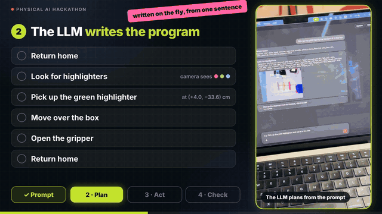

# Messy Desk reBot

**Tell a robot arm what to do in plain words, by typing or speaking, and it tidies your desk. Claude looks through an overhead camera, finds the highlighter you asked for, picks it up and drops it upright into the box. No training data, no new code per task.**

Built in about a day at Revolute Thanksgivathon 2026 (Physical AI Hackathon, FabLab Kendall, Cambridge MA).

## Team

| Name | GitHub | Role |
|------|--------|------|
| Pang | [@pangpulkes](https://github.com/pangpulkes) | |
| Tati | [@tatiitataaa](https://github.com/tatiitataaa) | |
| Branden | [@bmorioka](https://github.com/bmorioka) | |
| Meg | [@ms-meggles](https://github.com/ms-meggles) | |

## Demo



*"Pick up the green highlighter and put it in the box."* Claude plans the steps (go home → look for highlighters → pick up the green one → carry it over the box → open the gripper → go home), the arm does them, and the camera confirms the job is done.

## The idea

Getting a robot arm to do a new task usually means collecting many demonstrations and training a policy. We wanted to see how far you get **without any training**: let a large language model be the robot's planner, give it a few safe "skills" (look, find highlighters, pick at a table position, drop in the box, go home), and let anyone control the arm by just saying what they want.

We started with Claude choosing from **saved poses** recorded by hand. That worked, but only for a highlighter lying exactly where we had recorded the grab. So we added an **overhead camera** to find highlighters anywhere in a work area, and taught the arm how to grab by **showing it** a few times.

## How it works

```
 you: "put the pink highlighter in the box"   (typed or spoken in the control window)
          │
          ▼
 Claude (Messages API, tool use) ── plans the steps and calls tools ──┐
          ▲                                                           │
          │ photo + detections                                        ▼
 overhead camera ─► colour detection ─► table position (cm)     pick_at / drop_in_box / move_to_pose
                     (homography from 4 fiducials                     │
                      measured by the arm itself)                     ▼
                                          copy the nearest taught grab, turned to the new spot (IK)
                                                                      │
                                                                      ▼
                                          slow, safe motion (≤ 25°/s, always parks home on exit)
```

1. **Prompt.** A desktop-style control window with a text box, a 🎤 voice button, a live camera drawer and a big STOP button.
2. **Plan.** Claude gets the request and a small set of tools, and decides which to call and in what order.
3. **See.** `find_highlighters` finds coloured highlighters inside the calibrated square and returns each one's colour, table position and angle, plus an annotated photo for Claude to check.
4. **Pick.** `pick_at` doesn't trust the kinematic model alone. It **copies the nearest grab we taught by hand** (same gripper angle, height and offset), turned about the base to the new spot.
5. **Drop.** `drop_in_box` lifts the pen straight up, crosses over high, and lowers it upright into the box, so it never drags across the table.
6. **Check.** Claude looks again to confirm the highlighter is gone, then reports back.

- **Hardware:** Seeed **reBot Arm B601-RS** follower (6 RobStride motors + gripper, CAN bus, 48 V), **reBot Arm 102 (StarArm)** leader arm for teaching, PCAN-USB adapter, a 640×480 USB camera mounted overhead, a MacBook (Apple Silicon).
- **Software:** Python 3.12, [Seeed's LeRobot fork](https://github.com/Seeed-Projects/lerobot), **Claude Opus 5.5** via the Anthropic Messages API (manual tool-use loop, through MIT's Parley gateway), OpenCV, numpy forward/inverse kinematics from Seeed's URDF, FastAPI + a single HTML page, the browser's Web Speech API for voice.

## How we built it

- **Day 1 (evening):** Set up the Seeed LeRobot stack on a Mac. The tutorial assumes Linux SocketCAN, but we got the CAN follower running on macOS through MacCAN PCBUSB. Calibrated both arms.
- **Day 2 morning:** First teleoperation at 60 Hz. Picked the "Claude as planner, no training" approach. Recorded poses with the leader arm and wired Claude up to `move_to_pose` / `set_gripper` / `look`.
- **Day 2 midday:** Moved the camera overhead. Measured 4 table fiducials by touching them with the gripper tip (the arm as a ruler) to map camera pixels to table centimetres. Added colour detection and URDF kinematics.
- **Day 2 afternoon:** The first model-only pick missed, so we built "teach by showing" (lock the highlighter's position with the camera, grab it with the leader arm, save). Picks then worked well. Built the control window with voice, recorded a vertical drop pose, made the drop path lift straight up first, and moved calibration and teaching into the window (**Setup** panel).

## Results

- End-to-end voice/text → plan → pick → drop → self-check works on the real arm, with highlighters anywhere inside the ~44 × 29 cm calibrated square, lying forward or sideways.
- Picking uses **4 taught grabs**. The geometry-only approach missed. Copying the nearest taught grab made picks reliable in our tests.
- Camera calibration check: arm-measured fiducial spacing 44.3 × 28.9 cm vs. 44 × 29 cm with a ruler.
- Zero training data, and no new code per instruction. Claude chains the same tools for multi-step requests, e.g. two highlighters picked and dropped one after the other from a single request.

## Challenges

| Challenge | What we did |
|-----------|-------------|
| The follower arm's CAN bus needs Linux SocketCAN; we only had a Mac | Used the PCAN-USB adapter through MacCAN PCBUSB (`can0@1000000`). The whole stack runs on macOS. |
| Motors didn't answer at first | Reseated CAN wiring and checked 48 V power. A read-only ping script confirmed all 7 motors. |
| Which way does the wrist turn? (sign ambiguity in the model) | Measured fiducial spacing with a ruler and kept the sign that matched (44 × 29 cm). |
| First camera-guided pick missed completely | Stopped fighting the model: **teach by demonstration**. Picks copy the nearest taught grab and rotate it to the new spot. |
| A 48 V arm drops onto the table if motors just switch off | Every program, on quit / Ctrl+C / error, drives the arm home slowly before torque-off, and ignores a second Ctrl+C while parking. A STOP button freezes it in place. |
| Gripper couldn't point down at the old "above box" pose (wrist at its limit) | Recorded a new `drop_vertical` pose with the leader arm, pen upright over the box |
| On the way to the box the pen hit the table | `drop_in_box`: lift straight up using only the pitch joints (gripper angle kept), cross at 26 cm, lower straight down |
| USB camera sometimes froze after a crash | Unplug/replug. Only one program may hold the camera and arm at a time. |
| Lime-green arm parts look like a green highlighter | Detection is limited to the calibrated square; fold the arm home before looking |

## Run it yourself

You need the same hardware (reBot B601-RS follower + reBot 102 leader + USB camera) and a Claude API key.

```bash
git clone https://github.com/pangpulkes/messy-desk-rebot.git
cd messy-desk-rebot

# Python 3.12 env (we used conda env "rebot")
git clone https://github.com/Seeed-Projects/lerobot.git
pip install -e "lerobot[all]"
pip install -r requirements.txt

# calibrate the arms once with LeRobot (ids leader1 / follower1), see TECHNICAL.md
export ANTHROPIC_API_KEY=...            # your key (we used MIT Parley: also set ANTHROPIC_BASE_URL)
python ui_server.py --dry-run           # try the window without the arm
python ui_server.py                     # real arm: then Setup → Camera calibration, Teach grabs
```

On a Mac, the follower needs [MacCAN PCBUSB](https://www.mac-can.com) for the PCAN-USB adapter. `claude_arm_ui.sh` is our launcher (reads the key from the macOS Keychain). See **[TECHNICAL.md](TECHNICAL.md)** for the full setup, architecture, file map and how to redo each calibration step.

| File | What it does |
|------|--------------|
| `ui_server.py`, `ui.html` | Control window: prompt, voice, action cards, STOP / Home / Quit, Setup panel |
| `agent.py` | Claude tool loop, system prompt and tools (also a terminal version) |
| `arm.py` | Slow, safe follower controller (interpolation, hold thread, park-home-on-exit, leader follow) |
| `vision.py` | Colour detection → table coordinates |
| `picker.py`, `kin.py` | Taught-grab picking, URDF forward/inverse kinematics |
| `carry.py` | Safe drop into the box |
| `setup_flow.py`, `calibrate.py`, `teach_grasps.py`, `record_poses.py` | Camera calibration, grab teaching, pose recording |

## What's next

- Teach a few more grabs, especially in the middle of the square and at ~45° angles (the gripper only turns about ±25° today).
- More objects than highlighters: swap colour detection for an open-vocabulary detector.
- Place objects in specific spots ("line them up by colour"), not just in the box.
- Let Claude recover on its own when a grab fails (it can already see that the highlighter is still there).
- Run the same idea on other arms: only the poses, grabs and calibration are robot-specific.
